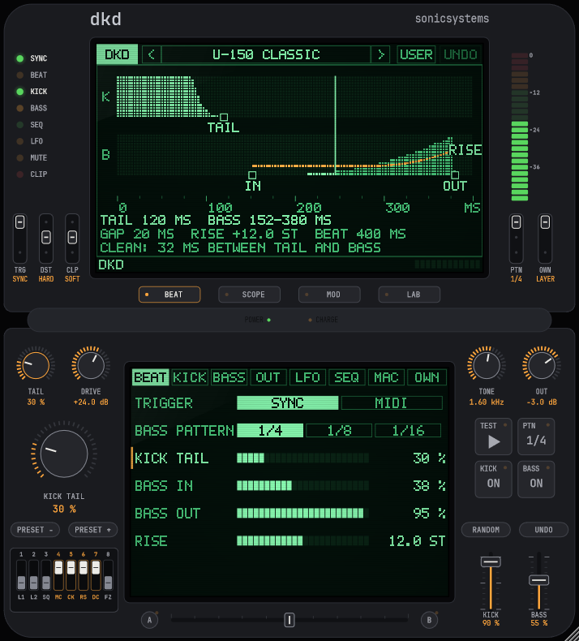

# dkd

**dkd (dualkickdeployment)** by sonicsystems: a hardstyle / rawstyle kick + reverse bass from one note. VST3 / CLAP instrument with LFOs, macros, a bass step sequencer and live scopes.

## Download

**[dkd 1.0.1 for Windows (VST3, 64-bit)](../../releases/latest)**: unzip `dkd.vst3` into `C:\Program Files\Common Files\VST3\` and rescan plugins.

## Build

    cmake -S src/DKD_kod_zrodlowy/dkd -B build -G Ninja -DCMAKE_BUILD_TYPE=Release
    cmake --build build --target DKD_VST3 DKDRender

Plugin code `Sdkd`, bundle / CLAP id `com.sonicsystems.dkd`.
