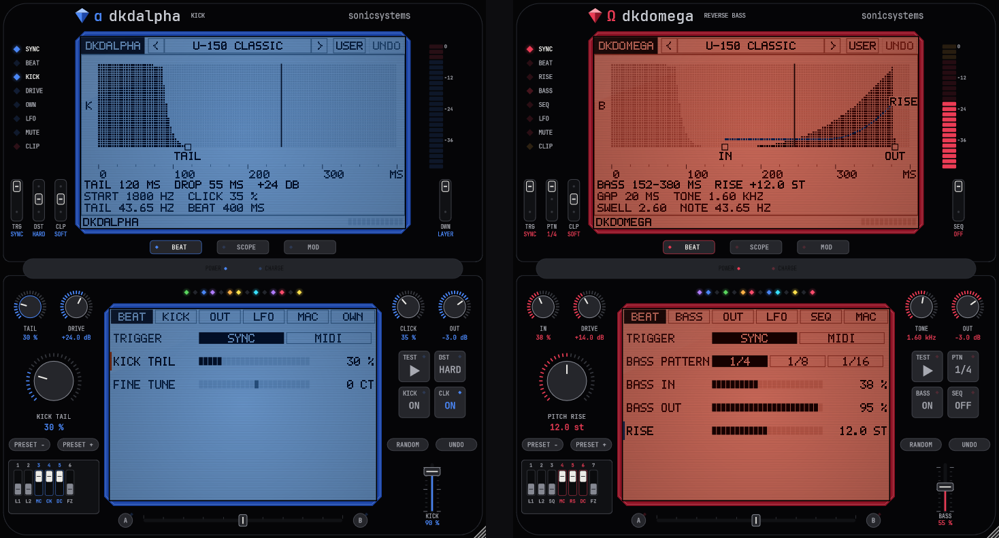

# dkd

Hardstyle / rawstyle kick + reverse bass by sonicsystems. VST3 / CLAP instruments with LFOs, macros, a bass step sequencer and live scopes.

- **dkdalpha**: the kick
- **dkdomega**: the reverse bass
- **dkd**: both from one note

## Download

**[Windows VST3, 64-bit: latest release](../../releases/latest)**: unzip the `.vst3` into `C:\Program Files\Common Files\VST3\` and rescan plugins.

## Build

    cmake -S src/DKDALPHA_kod_zrodlowy/dkdalpha -B build -G Ninja -DCMAKE_BUILD_TYPE=Release   # or DKDOMEGA_..., DKD_kod_zrodlowy/dkd
    cmake --build build
